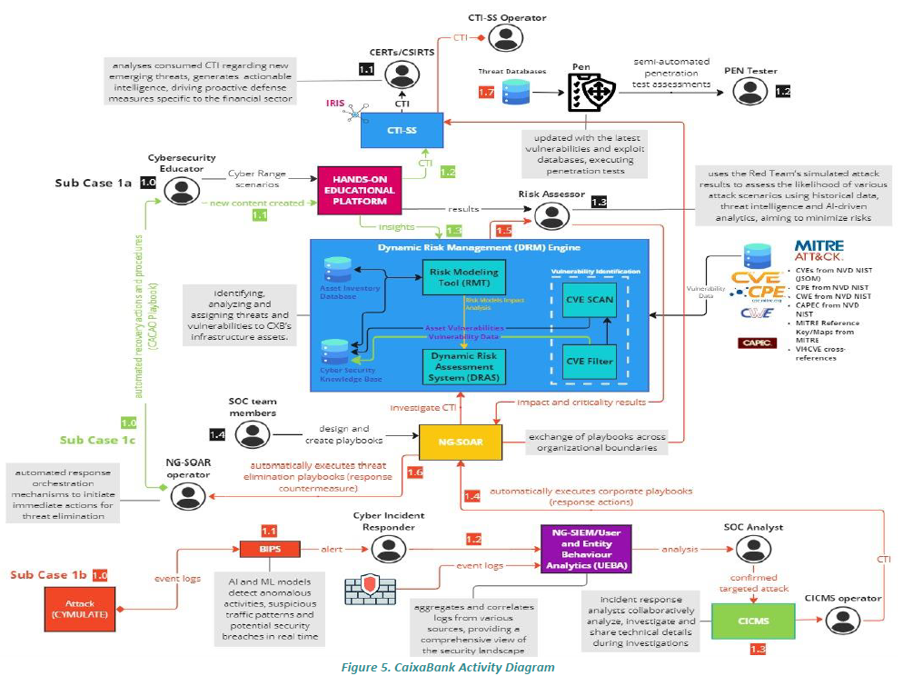

# Exercise 1 – Risk Assessment and Threat Modelling for a Banking System (PUC1 – Financial Sector)

## Scenario
You are the Cybersecurity Risk Manager for a major retail bank offering online services. Recent threat intelligence reports indicate that cybercriminal groups are targeting banking web applications and payment systems to commit fraud and exfiltrate sensitive customer data. Explore the virtual machines (`bank-analyst`, `bank-web`, `bank-db`) to identify high-value assets and possible attack paths.

### Environment Diagram


### Connection Guide
1. Open a terminal in the CyberRangeCZ interface.
2. Connect to the analysis workstation:
   ```bash
   ssh <user>@bank-analyst
   ```
3. From `bank-analyst`, connect to the web server and database:
   ```bash
   ssh <user>@bank-web
   ssh <user>@bank-db
   ```
   Replace `<user>` with the credentials provided by the instructor.
4. Use `nmap` to scan services on `bank-web` and `bank-db` and `wireshark` (or `tcpdump`) to capture traffic between the machines.

## Steps
1. Map critical assets and data flows between the provided machines.
2. Log into RITA and model bank assets, threats, and countermeasures following the [RITA guide](rita_guide.md).
3. Build threat scenarios using STRIDE and MITRE ATT&CK techniques.
4. Assess the likelihood and impact of each scenario.
5. Propose mitigations and prioritise them in a risk treatment plan.
6. Prepare documentation for technical and executive audiences.

## Deliverables

You do not fill anything in on this page — the tables here are read-only. Every
deliverable is produced in one of three places:

| Deliverable | Where you produce it |
|---|---|
| Asset inventory, threats, vulnerabilities, risk evaluation | **RITA** (the tool of record) |
| Threat model table | `~/deliverables/exercise1/threat_model.md` |
| Risk register | `~/deliverables/exercise1/risk_register.csv` |
| 5×5 risk matrix and risk ranking | `~/deliverables/exercise1/risk_matrix.md` |
| Risk treatment plan | `~/deliverables/exercise1/risk_treatment_plan.md` |
| Executive summary | `~/deliverables/exercise1/executive_summary.md` |
| RITA export (evidence) | `~/deliverables/exercise1/rita_export.csv` |

### Working files on the machine

The templates are pre-installed on `bank-analyst` under
`/home/debian/deliverables/exercise1/`. They are plain-text files, so you can
type into them:

```bash
ssh debian@bank-analyst
cd ~/deliverables/exercise1
ls -l
nano threat_model.md                    # or vim / mousepad
libreoffice --calc risk_register.csv    # spreadsheet view of the register
```

If the folder is missing, copy it from the course repository
(`content/templates/`) or recreate the files by hand — the questionnaire below
is what is graded, the files are the supporting evidence.

### How you submit your answers

When you finish, submit `Yes` on this level. The next level,
**Exercise 1 – Deliverables submission**, is a questionnaire with an answer box
for each deliverable: asset inventory, threat model, likelihood and impact
ratings for each scenario (a clickable 5×5 grid), risk ranking, treatment plan,
executive summary and the reflection questions. Copy the key lines from your
working files into those boxes. That questionnaire is what the instructor
reviews and scores.

Before moving on, run through
`~/deliverables/exercise1/submission_checklist.md`.

## Target Roles
- Cybersecurity Risk Manager
- Security Architect
- SOC Analyst

## Reflection Prompts
- Which threats require immediate mitigation and why?
- How would you communicate residual risk to leadership?

## Skills Covered
- Threat modelling, risk analysis, control design
- Risk communication and prioritisation
- Strategic decision-making under uncertainty
