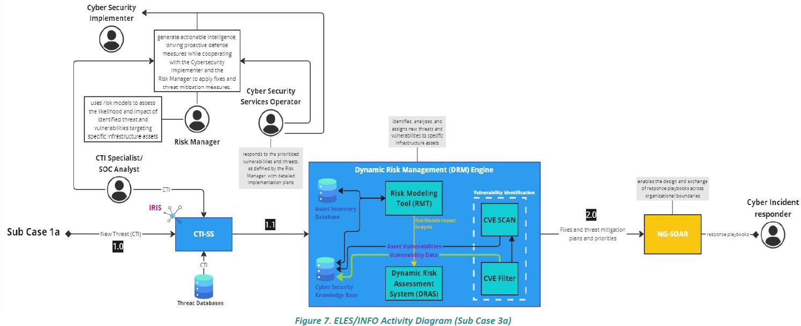

# Exercise 2 – Risk Assessment and Threat Modelling for an Energy Infrastructure (PUC3 – ICS Sector)

## Scenario
You are acting as the Cybersecurity Risk Manager for a national power transmission operator. The environment includes IT/OT interconnection, SCADA servers, RTUs and engineering workstations. Alerts about ICS-specific malware highlight the need for proactive risk analysis. Use the virtual machines (`corp-workstation`, `scada-server`, `substation-rtu`) to explore how the IT and OT networks interact.

### Environment Diagram


### Connection Guide
1. Open a terminal via the CyberRangeCZ interface.
2. Connect to the corporate workstation:
   ```bash
   ssh <user>@corp-workstation
   ```
3. From there, connect to the SCADA server and the substation RTU:
   ```bash
   ssh <user>@scada-server
   ssh <user>@substation-rtu
   ```
   Replace `<user>` with the login provided by the instructor.
4. Use tools such as `nmap` to map reachable services and `wireshark` to inspect industrial protocols.

## Steps
1. Identify ICS and IT assets critical to operations.
2. Use RITA to model ICS assets, potential threats and vulnerabilities as described in the [RITA guide](rita_guide.md).
3. Model threat scenarios such as malware propagation from IT to OT, insider manipulation of SCADA and unauthorised RTU commands.
4. Assess safety, operational and strategic impact.
5. Recommend controls suited for industrial environments.
6. Summarise findings in a risk report for leadership and engineers.

## Deliverables

The tables on this page are read-only. Every deliverable is produced in one of
three places:

| Deliverable | Where you produce it |
|---|---|
| ICS asset inventory, threats, vulnerabilities, risk evaluation | **RITA** (the tool of record) |
| ICS threat model (zones, conduits, attack vectors) | `~/deliverables/exercise2/threat_model.md` |
| Risk register | `~/deliverables/exercise2/risk_register.csv` |
| 5×5 risk matrix, operational and safety impact | `~/deliverables/exercise2/risk_matrix.md` |
| Mitigation plan for the OT network | `~/deliverables/exercise2/risk_treatment_plan.md` |
| Cyber risk report for leadership | `~/deliverables/exercise2/executive_summary.md` |
| RITA export (evidence) | `~/deliverables/exercise2/rita_export.csv` |

### Working files on the machine

The templates are pre-installed on `corp-workstation` under
`/home/debian/deliverables/exercise2/`:

```bash
ssh debian@corp-workstation
cd ~/deliverables/exercise2
ls -l
nano threat_model.md                    # or vim / mousepad
libreoffice --calc risk_register.csv    # spreadsheet view of the register
```

Rate **operational impact and safety impact separately** — in an ICS
environment a scenario with modest financial impact can still be the one that
endangers people or grid stability. `risk_matrix.md` has both scales.

### How you submit your answers

When you finish, submit `Yes` on this level. The next level,
**Exercise 2 – Deliverables submission**, is a questionnaire with an answer box
for each deliverable, plus clickable grids for likelihood, operational impact
and safety impact of each ICS scenario. Copy the key lines from your working
files into those boxes. That questionnaire is what the instructor reviews and
scores.

Before moving on, run through
`~/deliverables/exercise2/submission_checklist.md`.

## Target Roles
- Cybersecurity Risk Manager
- OT/ICS Security Analyst
- Security Architect

## Reflection Prompts
- What is the most significant safety risk identified?
- Which mitigations are most challenging to implement and why?

## Skills Covered
- ICS/OT-specific risk management
- Security architecture for critical infrastructure
- Balancing availability, safety and cyber defences
